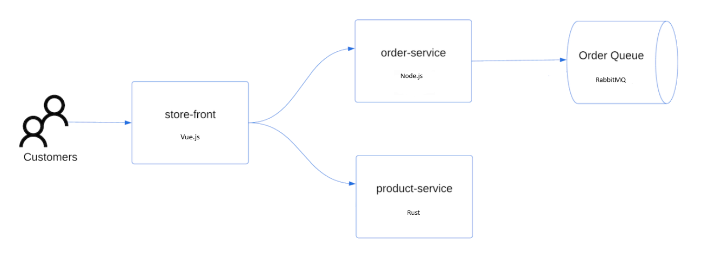
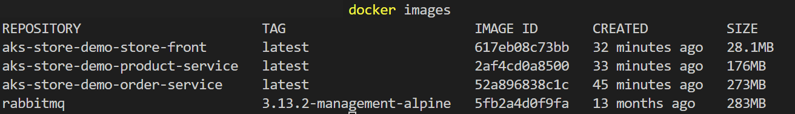
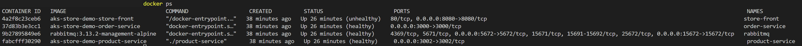
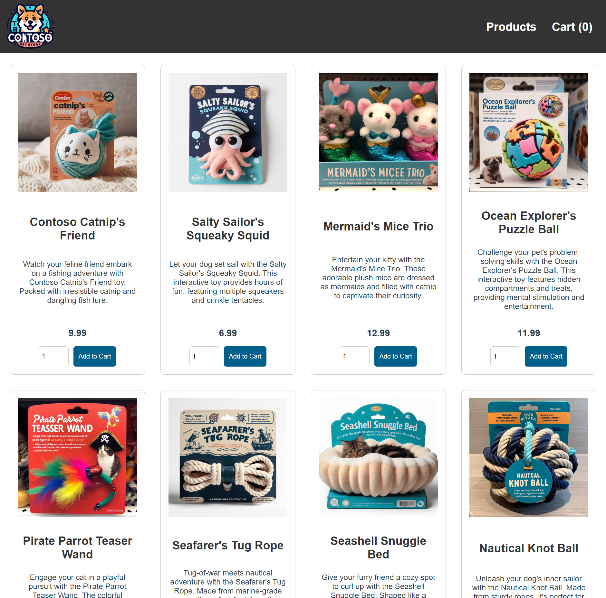

# 02. 샘플 애플리케이션 구성

## 개요와 학습 목표

이번 실습에서는 Azure Kubernetes Service(AKS)에서 사용할 샘플 애플리케이션을 구성합니다. Azure에서 제공되는 샘플 애플리케이션을 로컬에서 빌드하고 테스트한 후, AKS에서 이미지를 구성하는데 사용할 컨테이너 레지스트리(Azure Container Registry; ACR)에 업로드합니다.

## 사전 요구사항

[01. 준비 사항](../01-prerequisites/README.md)을 완료하고 Git과 Docker Engine을 사용할 수 있어야 합니다.

## 예상 소요 시간

약 35분을 예상합니다. 샘플 복제, 첫 이미지 다운로드·빌드, 앱 실행과 상품 목록 확인을 포함한 계획값이며 실측값은 아닙니다. 네트워크·프록시 문제 해결 시간은 별도로 확보합니다.

## 실습 단계

### 샘플 애플리케이션 복제

이 실습에서는 아래와 같은 샘플 애플리케이션을 사용합니다.



- **스토어 프런트**: 고객이 제품을 보고 주문을 할 수 있는 웹 애플리케이션
- **제품 서비스**: 제품 정보를 표시하는 서비스
- **주문 서비스**: 주문 서비스
- **Rabbit MQ**: 주문 큐에 대한 메시지 큐

1. 아래 명령어를 사용해서 샘플 애플리케이션을 로컬에 복제합니다.

    ```console
    git clone https://github.com/Azure-Samples/aks-store-demo.git
    cd aks-store-demo
    ```

2. Visual Studio Code 같은 IDE에서 해당 폴더를 엽니다. 이후 Docker 명령은 이 샘플 폴더에서 실행합니다.

`docker-compose-quickstart.yml`과 `aks-store-quickstart.yaml`이 있는 샘플 저장소 루트에서 명령을 실행합니다.

### 컨테이너 이미지 생성

1. 아래 명령어를 사용하여 컨테이너 이미지를 만들고, `docker compose` 명령어를 사용해서 애플리케이션을 시작합니다.

    ```console
    docker compose -f docker-compose-quickstart.yml up -d
    ```

2. `docker images` 명령어를 사용하여 생성된 이미지를 확인합니다.

    

3. `docker ps` 명령어를 사용하여 실행 중인 컨테이너를 확인합니다.

    

    `Up`은 컨테이너 실행 상태입니다. healthcheck 결과가 `unhealthy`라면 로그와 healthcheck 설정을 확인합니다.

4. 컨테이너가 정상적으로 실행 중이라면, 웹 브라우저에서 [http://localhost:8080](http://localhost:8080) 에 접속하여 샘플 애플리케이션을 확인합니다.

    

## 검증

샘플 폴더에서 컨테이너 상태를 확인합니다.

```console
docker compose -f docker-compose-quickstart.yml ps
```

`order-service`, `product-service`, `store-front`, `rabbitmq`가 실행 상태이고 브라우저에서 `http://localhost:8080`의 상품 목록이 표시되면 성공입니다.

## 정리

생성한 이미지와 샘플 소스는 다음 랩에 필요하므로 유지합니다. 전체 실습을 마치면 [07. 리소스 정리](../07-cleanup/README.md)에서 로컬 컨테이너도 정리합니다.

## 트러블슈팅

| 증상 | 확인과 조치 |
|---|---|
| Compose 파일을 찾을 수 없음 | 현재 위치가 `aks-store-demo` 폴더인지 확인합니다. |
| Docker Engine 연결 오류 | Docker Desktop을 실행하고 [준비 사항의 검증](../01-prerequisites/README.md#검증)을 다시 수행합니다. |
| 이미지 빌드 중 npm 설치가 실패함 | 빌드 로그의 registry 주소와 오류를 확인합니다. 호스트 npm 설정은 Docker 빌드에 자동 적용되지 않습니다. `TLS_ALERT_HANDSHAKE_FAILURE`가 보이면 승인된 네트워크·프록시·인증서 설정을 확인하고 아래 안내를 따릅니다. 인증서 검증을 끄거나 비공식 registry로 바꾸지 않습니다. |
| 컨테이너가 종료되거나 반복 재시작함 | 아래 명령으로 로그를 확인합니다. 실패한 서비스의 빌드·연결 오류를 먼저 해결합니다. |
| 실행 중인 컨테이너가 `unhealthy`로 표시됨 | 앱 로그와 Compose 파일의 healthcheck 대상 포트·경로를 확인합니다. `Up` 표시만으로 healthcheck 성공을 판단하지 않습니다. |
| `localhost:8080`에 접속할 수 없음 | `store-front`가 실행 중이고 호스트의 8080 포트가 다른 프로그램에 사용되지 않는지 확인합니다. |

```console
docker compose -f docker-compose-quickstart.yml logs --tail=100
```

로그를 공유할 때는 키·연결 문자열·개인 리소스 식별자를 가립니다.

### npm registry 연결 문제 해결

샘플은 기본적으로 공개 npm registry인 `https://registry.npmjs.org/`를 사용합니다. 이 주소에 정상적으로 연결되는 환경에서는 별도 설정 없이 앞의 실습 명령을 그대로 사용합니다.

회사·학교 네트워크에서 별도 npm registry나 registry proxy를 사용해야 한다면 관리자에게 주소와 접근 방법을 확인합니다. 호스트에 npm이 설치돼 있다면 `npm config get registry`로 현재 주소를 확인할 수 있지만, 이 설정은 Docker 빌드에 자동으로 전달되지 않습니다. Compose 서비스의 실행용 `environment` 설정도 Dockerfile의 `RUN npm install`에는 적용되지 않습니다.

별도 registry 주소를 전달해야 할 때만 로컬 샘플의 `src/order-service/Dockerfile`과 `src/store-front/Dockerfile`에서 npm 설치 전에 다음 build argument를 선언합니다. 공개 registry 기본값은 유지합니다.

```dockerfile
ARG NPM_REGISTRY=https://registry.npmjs.org/
```

기존 설치 옵션을 유지하면서 registry를 전달합니다. `order-service`는 다음과 같이 변경합니다.

```dockerfile
RUN npm install --production --registry="$NPM_REGISTRY"
```

`store-front`는 다음과 같이 변경합니다.

```dockerfile
RUN npm install --registry="$NPM_REGISTRY"
```

샘플 폴더에서 해당 환경의 registry 주소를 build argument로 전달한 뒤 앱을 시작합니다. 아래 `https://registry.example.com/npm/`은 실행용 주소가 아닌 표기 예시입니다. 반드시 관리자가 안내한 실제 주소로 바꿉니다.

```console
docker compose -f docker-compose-quickstart.yml build --build-arg NPM_REGISTRY=https://registry.example.com/npm/
docker compose -f docker-compose-quickstart.yml up -d
```

이 설정은 registry 주소를 선택하는 방법이며, 네트워크 프록시나 인증서 문제를 모두 해결하지는 않습니다. TLS 오류가 계속되면 Docker 빌드 환경의 프록시와 신뢰할 인증서 설정을 관리자와 확인합니다. 인증이 필요한 registry의 토큰·비밀번호는 Dockerfile이나 build argument에 넣지 않고, 해당 환경의 안전한 자격 증명 전달 방법을 따릅니다.

`npm ping`이 404여도 registry proxy가 ping API를 제공하지 않는 것일 수 있으므로 실제 패키지 조회·다운로드 결과와 빌드 종료 상태를 확인합니다. 인증서 검증을 끄거나 출처를 확인하지 않은 registry를 사용하지 않습니다.

## 이전·다음

[이전: 준비 사항](../01-prerequisites/README.md) · [다음: 컨테이너 레지스트리 만들기](../03-container-registry/README.md)