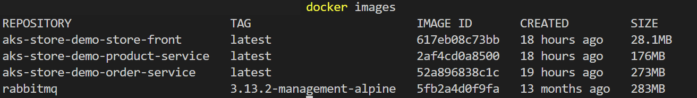
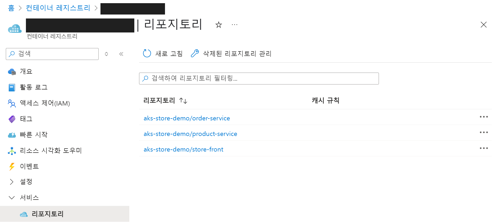

# 03. 컨테이너 레지스트리 만들기

## 개요와 학습 목표

컨테이너 레지스트리(Azure Container Registry; ACR)은 컨테이너 이미지를 위한 프라이빗 레지스트리입니다. 프라이빗 컨테이너 레지스트리를 사용하면 애플리케이션과 사용자 지정 코드를 안전하게 빌드하고 배포할 수 있습니다.

리소스 그룹과 ACR을 만들고 세 앱 이미지를 업로드합니다.

## 사전 요구사항

[02. 샘플 애플리케이션 구성](../02-sample-application/README.md)을 완료하고 샘플 폴더에서 로컬 터미널을 엽니다. Azure 구독과 리소스 생성 권한이 필요합니다.

## 예상 소요 시간

약 25분을 예상합니다. 리소스 그룹·ACR 생성, 로그인, 세 이미지의 태그 지정·업로드와 확인을 포함한 계획값이며 실측값은 아닙니다. 이미지가 이미 빌드된 상태를 전제로 하며, 업로드 시간은 이미지 크기와 네트워크 속도에 따라 달라집니다.

## 실습 단계

### 리소스 그룹 만들기

Azure의 모든 리소스는 생성할 때 과금이 청구될 구독과 리소스들의 논리 컨테이너인 리소스 그룹을 지정해줘야 합니다.

먼저 [Azure 포털](https://portal.azure.com/)로 이동합니다.

1. 서비스 검색 상자에서 `리소스 그룹`을 입력합니다.
2. 왼쪽 상단의 `만들기` 버튼을 클릭합니다.
3. 아래와 같이 구성하고 하단의 `검토 + 만들기` 버튼을 클릭하고 `만들기` 버튼을 클릭하여 리소스를 생성합니다.
    - 구독 : 사용할 구독 선택
    - 리소스 그룹 이름 : AKSWorkshopResourceGroup
    - 지역 : (Asia Pacific) Korea Central

### 컨테이너 레지스트리 만들기

1. 서비스 검색 상자에서 `컨테이너 레지스트리`를 입력합니다.
2. 왼쪽 상단의 `만들기` 버튼을 클릭합니다.
3. 앞서 선택한 구독과 생성한 `AKSWorkshopResourceGroup` 리소스 그룹을 선택하고 아래와 같이 구성합니다.
    - 레지스트리 이름 : `<alias>samplerepo` (`<alias>`를 자신의 영문·숫자 식별자로 바꿉니다.)
    - 위치 : Korea Central
    - 가격 책정 플랜 : 표준
4. 나머지 구성은 그대로 두고 `검토 + 만들기` 버튼을 클릭하고 `만들기` 버튼을 클릭하여 리소스를 생성합니다.

### 컨테이너 이미지를 레지스트리에 푸시

1. 로컬에서 터미널을 열어 docker images 명령어를 입력하여 로컬에 빌드된 이미지를 확인합니다.

    

2. 이미지가 정상적으로 빌드되어 있다면, rabbitmq를 제외하고 `aks-store-demo` 세 개의 이미지를 푸시할 것입니다. 이미지가 빌드되어 있지 않다면 아래 명령어를 로컬 터미널(샘플 애플리케이션 경로)에서 실행하여 이미지를 빌드합니다.

    ```console
    docker compose -f docker-compose-quickstart.yml build
    ```

3. 레지스트리 이름을 환경 변수에 넣습니다. 아래 예시의 `youruniquesamplerepo`는 예시 값이므로 실제 생성한 이름으로 바꿉니다. CMD와 Bash 중 하나를 선택하고 이후 로그인·태그·푸시도 같은 터미널에서 실행합니다.
4. `az login`으로 로그인하고 `az acr login`으로 레지스트리에 로그인합니다. 여러 테넌트를 사용한다면 `az login --tenant` 뒤에 실제 디렉터리 ID를 지정합니다.
5. `docker tag`로 세 앱 이미지에 ACR 로그인 서버 주소를 붙입니다. RabbitMQ 이미지는 이번 단계의 업로드 대상이 아닙니다.
6. `docker push`로 세 이미지를 업로드합니다.

   **Windows CMD**

   ```cmd
   set "ACRNAME=youruniquesamplerepo"
   az login
   az acr login --name %ACRNAME%
   docker tag aks-store-demo-order-service:latest %ACRNAME%.azurecr.io/aks-store-demo/order-service:latest
   docker tag aks-store-demo-store-front:latest %ACRNAME%.azurecr.io/aks-store-demo/store-front:latest
   docker tag aks-store-demo-product-service:latest %ACRNAME%.azurecr.io/aks-store-demo/product-service:latest
   docker push %ACRNAME%.azurecr.io/aks-store-demo/order-service:latest
   docker push %ACRNAME%.azurecr.io/aks-store-demo/store-front:latest
   docker push %ACRNAME%.azurecr.io/aks-store-demo/product-service:latest
   ```

   **Bash (Linux, macOS, Git Bash)**

   ```bash
   export ACRNAME=youruniquesamplerepo
   az login
   az acr login --name "$ACRNAME"
   docker tag aks-store-demo-order-service:latest "$ACRNAME.azurecr.io/aks-store-demo/order-service:latest"
   docker tag aks-store-demo-store-front:latest "$ACRNAME.azurecr.io/aks-store-demo/store-front:latest"
   docker tag aks-store-demo-product-service:latest "$ACRNAME.azurecr.io/aks-store-demo/product-service:latest"
   docker push "$ACRNAME.azurecr.io/aks-store-demo/order-service:latest"
   docker push "$ACRNAME.azurecr.io/aks-store-demo/store-front:latest"
   docker push "$ACRNAME.azurecr.io/aks-store-demo/product-service:latest"
   ```

7. Azure 포털로 이동하여 컨테이너 레지스트리 화면으로 이동합니다.
8. 레지스트리 목록에서 생성한 `<alias>samplerepo` 를 클릭합니다.
9. 왼쪽의 블레이드에서 `서비스`를 클릭하고 `리포지토리`를 클릭하여 업로드된 이미지를 확인합니다.

    

## 검증

Azure 포털의 `리포지토리` 목록에서 `aks-store-demo/order-service`, `aks-store-demo/store-front`, `aks-store-demo/product-service`와 각 `latest` 태그를 확인합니다.

## 정리

ACR은 다음 랩의 AKS 구성과 앱 배포에 필요하므로 유지합니다. 최종 정리는 [07. 리소스 정리](../07-cleanup/README.md)를 따릅니다.

## 트러블슈팅

| 증상 | 확인과 조치 |
|---|---|
| ACR 이름을 사용할 수 없음 | 레지스트리 이름이 전역에서 고유한지 확인하고 자신의 영문·숫자 식별자로 바꿉니다. |
| 로그인 실패 또는 권한 오류 | `az login`을 다시 실행하고 실습 구독을 선택했는지 확인합니다. 이미지 업로드 권한이 없으면 관리자에게 요청합니다. |
| 로컬 이미지가 없음 | 샘플 폴더에서 `docker compose -f docker-compose-quickstart.yml build`를 실행하고 `docker images`의 실제 이름을 확인합니다. |
| 이미지 태그가 없음 | 빌드 이미지 이름이 예시와 다르면 `docker tag`의 원본 이미지 이름을 실제 값으로 바꿉니다. 대상 경로와 태그는 이후 배포 manifest에도 동일하게 사용합니다. |
| 환경 변수가 비어 있거나 이름이 그대로 보임 | 같은 터미널에서 ACRNAME을 설정했는지 확인합니다. CMD는 `%ACRNAME%`, Bash는 `$ACRNAME`을 사용합니다. |

로그인한 구독은 아래 명령으로 확인합니다. 구독 이름이 실습 대상과 다르면 올바른 구독을 선택한 뒤 진행합니다.

```console
az account show --query name --output tsv
```

## 이전·다음

[이전: 샘플 애플리케이션 구성](../02-sample-application/README.md) · [다음: AKS 클러스터 만들기](../04-aks-cluster/README.md)