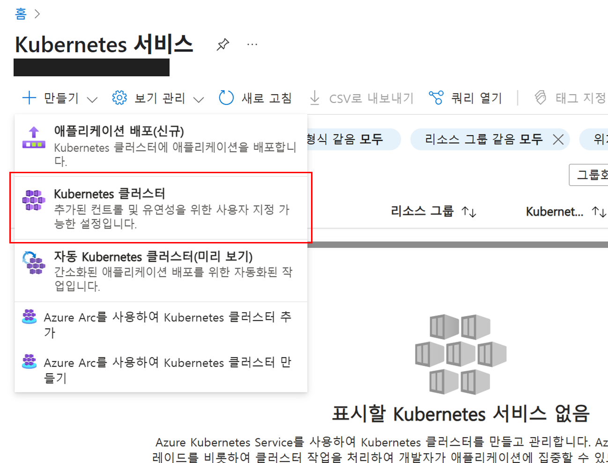
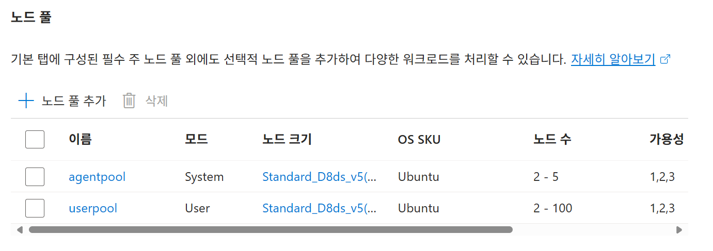
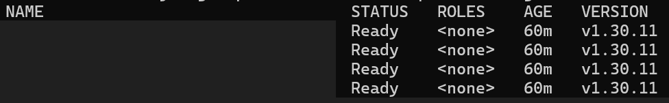

# 04. AKS 클러스터 만들기

## 개요와 학습 목표

Kubernetes는 컨테이너화된 애플리케이션에 대해 분산 플랫폼을 제공합니다. AKS(Azure Kubernetes Service)를 사용하면 프로덕션 준비 Kubernetes 클러스터를 신속하게 만들 수 있습니다.

AKS 클러스터를 만들고 ACR 연결을 구성한 뒤 kubectl로 노드를 확인합니다.

## 사전 요구사항

[03. 컨테이너 레지스트리 만들기](../03-container-registry/README.md)를 완료하고 Azure CLI와 kubectl을 사용할 수 있어야 합니다.

## 예상 소요 시간

약 30분을 예상합니다. 포털 설정, 클러스터 생성 대기, ACR 연결과 kubectl 노드 확인을 포함한 계획값이며 실측값은 아닙니다. 리전의 가용 자원과 구독 할당량에 따라 대기 시간이 늘어날 수 있습니다.

## 실습 단계

### AKS 클러스터 만들기

1. Azure 포털 서비스 검색 상자에서 `AKS` 또는 `Kubernetes 서비스`를 입력합니다.
2. 왼쪽 상단의 `만들기` 버튼을 클릭합니다.
3. `Kubernetes 클러스터`를 선택합니다.

    

4. 기본 사항 탭을 아래와 같이 구성합니다.
    - 구독 : 사용할 구독 선택
    - 리소스 그룹 : AKSWorkshopResourceGroup
    - 클러스터 사전 설정 구성 : 프로덕션 표준
    - Kubernetes 클러스터 이름 : AKSSampleCluster
    - 지역 : (Asia Pacific) Korea Central
    - 인증 및 권한 부여 : Kubernetes RBAC가 있는 로컬 계정

    > **참고:** AKS는 다음의 세 가지 인증 및 권한 부여 방법을 제공합니다.

    - Kubernetes RBAC가 있는 로컬 계정
    - Kubernetes RBAC를 사용한 Microsoft Entra ID 인증
    - Azure RBAC를 사용한 Microsoft Entra ID 인증

5. 나머지 설정은 그대로 두고 `다음` 버튼을 클릭합니다.
6. 노드 풀에서 아래 항목을 확인하고 `다음` 버튼을 클릭합니다.

    

    - agentpool (시스템 노드 풀) : CoreDNS 및 konnectivity와 같은 중요 시스템 Pod를 호스트
    - userpool (사용자 노드 풀) : 컴퓨팅 또는 스토리지 수요가 다른 애플리케이션을 지원, 애플리케이션 Pod를 호스트
7. 네트워킹 탭에서 아래 항목들을 확인하고 `다음` 버튼을 클릭합니다.
    - 컨테이너 네트워킹
        - 네트워크 구성 : Azure CNI 오버레이
        - 네트워크 정책 : 없음
8. 통합 탭에서 Azure Container Registry에서 생성한 `<alias>samplerepo`를 선택하고 `다음` 버튼을 클릭합니다.
9. 모니터링 탭에서 아래와 같이 구성하고 `검토 + 만들기` 버튼을 클릭합니다.
    - 컨테이너 인사이트
        - 컨테이너 로그 사용 : 체크
        - Log Analytics 작업 영역
            - 새로 만들기 클릭
            - 지역 : (Asia Pacific) Korea Central
            - 리소스 그룹 : 자동 지정
            - Log Analytics 작업 영역 : AKSLogWorkspace
10. 검토 + 만들기 화면에서 구성한 내용을 확인하고 `만들기` 버튼을 클릭합니다. (클러스터 생성에는 10~15분이 소요됩니다.)

### kubectl을 사용하여 클러스터에 연결

1. `az aks get-credentials` 명령을 사용하여 Kubernetes 클러스터에 연결하도록 `kubectl`을 구성합니다. (일반적으로 User 디렉터리\.kube\config 파일에 구성이 설정됩니다.)

    ```console
    az aks get-credentials --resource-group AKSWorkshopResourceGroup --name AKSSampleCluster
    ```

2. 아래 명령어를 실행하여 정상적으로 클러스터에 연결되는지 테스트합니다.

    ```console
    kubectl get nodes
    ```

    

## 검증

`kubectl get nodes`에서 노드가 표시되고 모든 노드의 `STATUS`가 `Ready`이면 연결과 노드 준비를 확인한 것입니다. `NotReady`가 남아 있으면 앱을 배포하기 전에 노드 상태를 해결합니다.

## 정리

클러스터와 연결한 리소스는 이후 랩에서 사용합니다. 전체 실습을 마친 뒤 [07. 리소스 정리](../07-cleanup/README.md)를 따릅니다.

## 트러블슈팅

| 증상 | 확인과 조치 |
|---|---|
| 클러스터 생성 실패 | Azure 포털의 배포 오류에서 해당 리전의 VM 크기·vCPU 할당량과 정책 제한을 확인합니다. 설정 변경이 필요하면 강사나 구독 관리자에게 문의합니다. |
| ACR이 선택 목록에 없음 | 생성한 ACR과 선택한 구독·리소스 그룹을 확인합니다. 레지스트리 접근 권한도 확인합니다. |
| 클러스터에 연결할 수 없음 | Azure CLI의 로그인·구독을 확인하고 `az aks get-credentials`에 올바른 리소스 그룹·클러스터 이름을 넣어 다시 실행합니다. |
| 다른 클러스터가 조회됨 | `kubectl config current-context`와 `kubectl config get-contexts`를 확인합니다. 실습 클러스터가 아닌 상태에서 배포하지 않습니다. |
| 노드가 `NotReady` 상태임 | 아래 명령으로 노드의 Conditions와 Events를 확인합니다. |

```console
kubectl describe nodes
```

## 이전·다음

[이전: 컨테이너 레지스트리 만들기](../03-container-registry/README.md) · [다음: 클러스터에 애플리케이션 배포](../05-application-deployment/README.md)