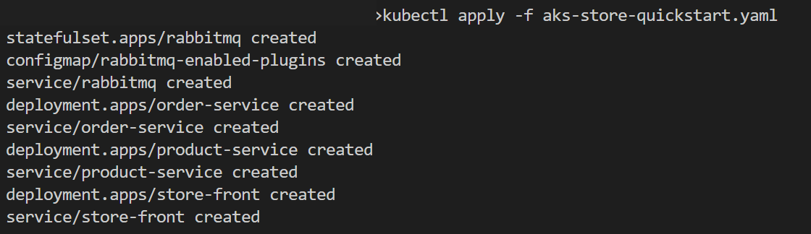
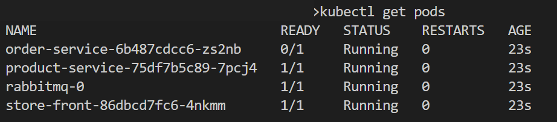
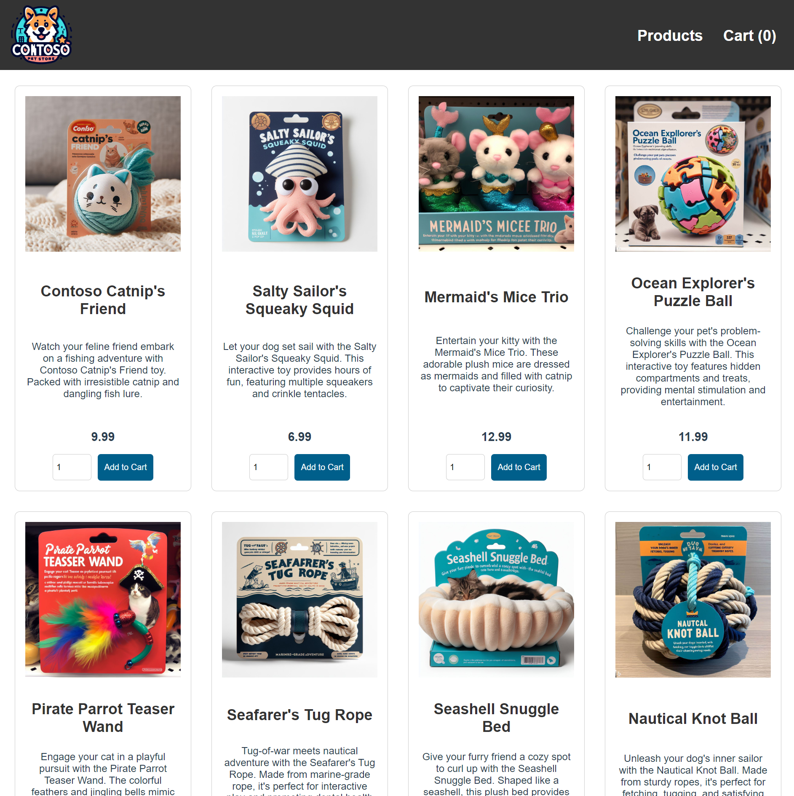

# 05. AKS에 애플리케이션 배포

## 개요와 학습 목표

이번 실습에서는 샘플 애플리케이션을 Kubernetes 클러스터에 배포합니다.

이 전 단계에서 애플리케이션을 컨테이너 이미지로 패키지하고, 컨테이너 레지스트리에 업로드했습니다. 이 실습에서는 로컬에 다운로드 받은 소스코드의 Kubernetes 매니페스트 파일을 수정하여 애플리케이션을 AKS 클러스터에 배포해보도록 하겠습니다.

## 사전 요구사항

[04. AKS 클러스터 만들기](../04-aks-cluster/README.md)를 완료하고 kubectl 연결을 확인합니다. [03. 컨테이너 레지스트리 만들기](../03-container-registry/README.md)에서 업로드한 세 앱 이미지와 로컬 샘플 소스가 필요합니다.

## 예상 소요 시간

약 25분을 예상합니다. 세 이미지 주소 수정, manifest 적용, 이미지 가져오기·공용 IP 할당 대기와 상품 목록 확인을 포함한 계획값이며 실측값은 아닙니다.

## 실습 단계

### 매니페스트 파일 업데이트

ACR(Azure Container Registry) 인스턴스는 샘플 애플리케이션에 대한 컨테이너 이미지를 저장합니다. 애플리케이션을 배포하려면 ACR 로그인 서버 이름을 포함하도록 Kubernetes 매니페스트 파일의 이미지 이름을 업데이트해야 합니다.

3번 실습에서 구성한 ACR 이름을 사용합니다.

1. Visual Studio Code(또는 사용하는 IDE)에서 로컬에 다운로드 받은 `aks-store-demo` 디렉터리 내에 `aks-store-quickstart.yaml` 매니페스트 파일을 엽니다.
2. `order-service`, `product-service`, `store-front` Deployment의 컨테이너 `image`를 아래 ACR 이미지 주소로 바꿉니다. 이번 랩에서는 직접 업로드한 `latest` 태그를 사용합니다. RabbitMQ 이미지는 변경하지 않습니다.

   `<your-acr-name>`을 실제 ACR 이름으로 바꿉니다. 아래 코드는 이미지 주소만 보여주는 부분 예시이며, manifest 전체를 대체하지 않습니다.

    `order-service`:

    ```yaml
    image: <your-acr-name>.azurecr.io/aks-store-demo/order-service:latest
    ```

    `product-service`:

    ```yaml
    image: <your-acr-name>.azurecr.io/aks-store-demo/product-service:latest
    ```

    `store-front`:

    ```yaml
    image: <your-acr-name>.azurecr.io/aks-store-demo/store-front:latest
    ```


### 애플리케이션 실행

1. `kubectl apply` 명령어를 사용하여 애플리케이션을 배포합니다.

    ```console
    kubectl apply -f aks-store-quickstart.yaml
    ```

    

2. `kubectl get pods` 명령어를 사용하여 애플리케이션 배포가 정상적으로 실행되었는지 확인합니다.

    ```console
    kubectl get pods
    ```

    

    `Running`이어도 `READY`가 `0/1`이면 아직 준비되지 않은 상태입니다. 아래 검증 단계에서 rollout 완료와 `READY`를 함께 확인합니다.


### 애플리케이션 테스트

애플리케이션이 실행되면 애플리케이션 프런트 엔드를 인터넷에 공개하는 Kubernetes 서비스가 만들어집니다. 이 프로세스를 완료하는 데 몇 분이 걸릴 수 있습니다.

1. `kubectl get service` 명령어와 `--watch` 옵션을 사용하여 진행률을 모니터링합니다.
    ```console
    kubectl get service store-front --watch
    ```
2. `store-front` 서비스의 `EXTERNAL-IP`가 공용 IP 주소로 변경되면 `Ctrl-C`를 사용하고 공용 IP를 복사하여 브라우저에 입력합니다.

    

## 검증

다음 명령으로 세 앱의 배포 완료 여부를 확인합니다. 각 명령은 최대 5분 동안 기다리며, 시간이 초과되면 아래 트러블슈팅으로 원인을 확인합니다.

```console
kubectl rollout status deployment/order-service --timeout=5m
kubectl rollout status deployment/product-service --timeout=5m
kubectl rollout status deployment/store-front --timeout=5m
kubectl get pods
kubectl get service store-front
```

세 Deployment의 rollout이 완료되고 앱 Pod의 `READY`가 모두 준비 상태여야 합니다. `store-front`의 `EXTERNAL-IP`를 브라우저에 입력해 상품 목록이 표시되면 성공입니다.

## 정리

배포한 앱은 다음 Service Bus 연동 랩에서 사용합니다. 리소스를 유지하고 최종 정리는 [07. 리소스 정리](../07-cleanup/README.md)를 따릅니다.

## 트러블슈팅

| 증상 | 확인과 조치 |
|---|---|
| `ImagePullBackOff` 또는 `ErrImagePull` | ACR 이름, 리포지토리 경로, `latest` 태그가 업로드한 이미지와 일치하는지 확인합니다. AKS와 ACR의 연결·이미지 가져오기 권한도 확인합니다. |
| `CrashLoopBackOff` | 아래 명령으로 Pod 상태와 앱 로그를 확인합니다. RabbitMQ 상태와 주문 서비스의 연결 설정을 점검합니다. |
| `Pending` | Pod Events에서 노드 자원 부족이나 스케줄링 제한을 확인합니다. |
| `EXTERNAL-IP`가 계속 `<pending>`임 | Service의 `type`이 `LoadBalancer`인지 확인하고 Service Events의 IP 할당 오류·할당량 제한을 확인합니다. |
| 배포가 다른 클러스터에 적용됨 | 작업 전에 `kubectl config current-context`로 실습 클러스터를 확인합니다. 잘못 적용했다면 강사와 대상 범위를 확인한 뒤 정리합니다. |

```console
kubectl describe pods
kubectl logs deployment/order-service --tail=100
kubectl describe service store-front
```

로그·Events를 공유할 때 실제 키와 개인 리소스 식별자는 가립니다.

## 이전·다음

[이전: AKS 클러스터 만들기](../04-aks-cluster/README.md) · [다음: PaaS 연동](../06-service-bus-integration/README.md)