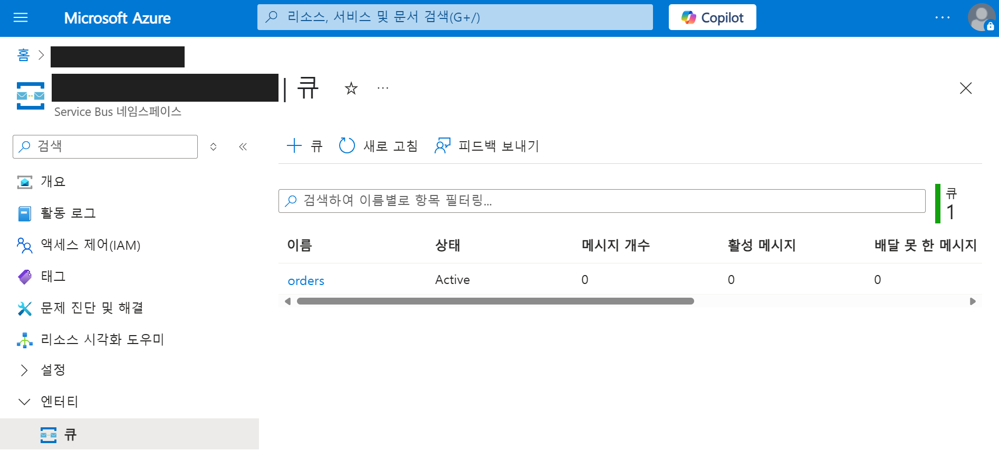
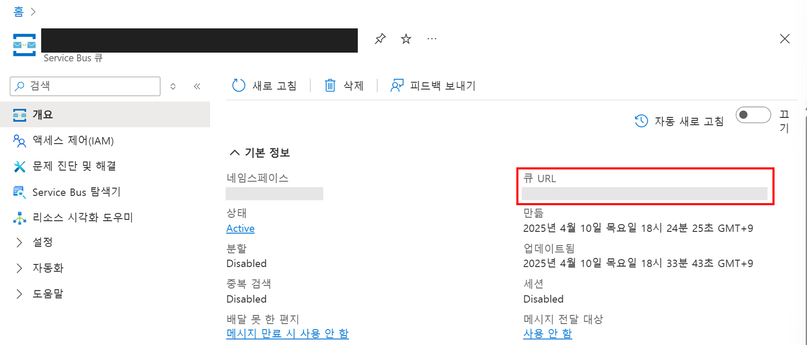
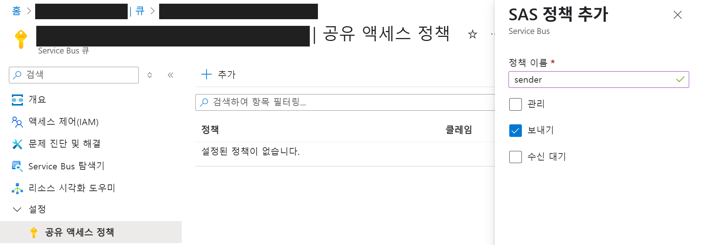
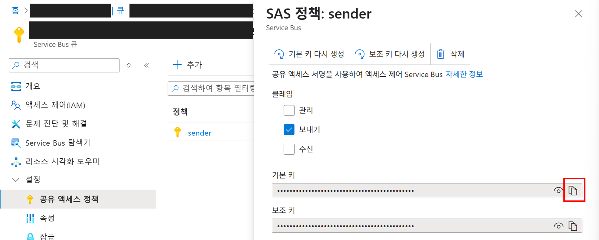
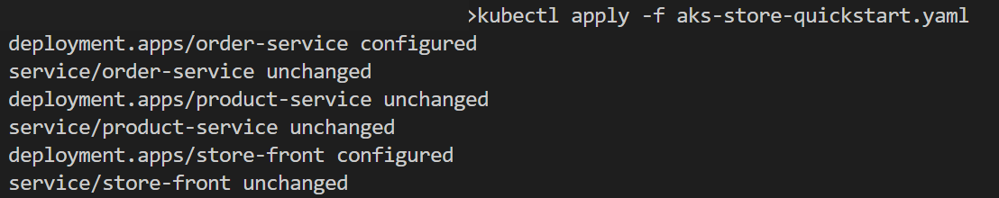
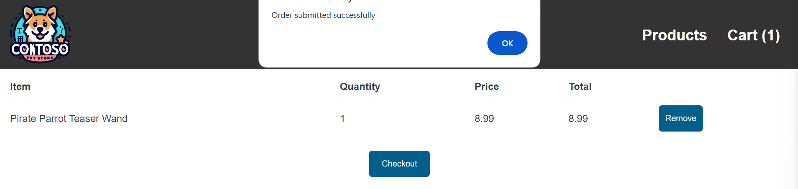
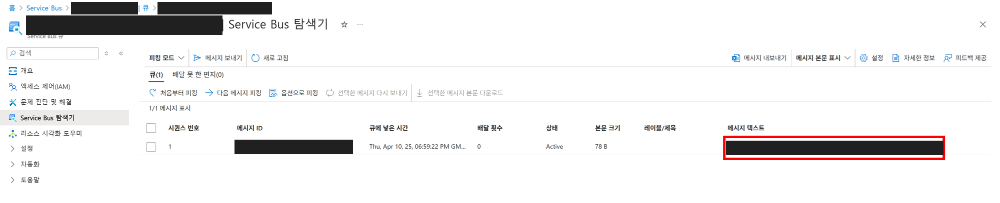

# 06. PaaS 연동

## 개요와 학습 목표

AKS 클러스터에서는 Azure의 다른 PaaS 서비스와의 연동을 구성할 수 있습니다. 샘플 애플리케이션은 order-service에서 요청한 주문을 RabbitMQ 컨테이너에 저장합니다.

Azure Service Bus는 메시지 큐와 Pub-Sub 토픽이 있는 관리형 엔터프라이즈 메시지 브로커입니다. Service Bus 큐를 사용하여 애플리케이션 간 메시지를 주고 받을 수 있도록 구성해 보도록 하겠습니다.

## 사전 요구사항

[05. 클러스터에 애플리케이션 배포](../05-application-deployment/README.md)를 완료하고 샘플 앱을 사용할 수 있어야 합니다. Service Bus를 생성하고 큐·공유 액세스 정책을 설정할 권한이 필요합니다.

## 예상 소요 시간

약 30분을 예상합니다. 네임스페이스·큐·보내기 정책 생성, manifest 수정, 앱 업데이트 대기와 주문 메시지 확인을 포함한 계획값이며 실측값은 아닙니다.

## 실습 단계

### 네임스페이스 만들기

1. Azure 포털 서비스 검색 상자에서 `Service Bus`를 입력합니다.
2. 왼쪽 상단 `만들기` 버튼을 클릭합니다.
3. 아래와 같이 구성하고 `검토 + 만들기`, `만들기` 버튼을 클릭하여 네임스페이스를 생성합니다.
    - 구독 : 사용할 구독 선택
    - 리소스 그룹 : AKSWorkshopResourceGroup
    - 네임스페이스 이름 : `store-demo-<alias>` (`<alias>`를 자신의 식별자로 바꿉니다.)
    - 위치 : Korea Central
    - 가격 책정 계층 : 표준

#### 비용 확인

Standard 계층에는 구독 단위 기본 요금이 있으며, 포함량을 초과한 메시징 작업·연결에는 추가 요금이 발생합니다. Korea Central의 월 최초 13M 작업 포함량과 현재 단가는 [Service Bus 가격표](https://azure.microsoft.com/en-us/pricing/details/service-bus/)와 [과금 FAQ](https://learn.microsoft.com/ko-kr/azure/service-bus-messaging/service-bus-faq#pricing)를 확인합니다.

리소스를 만들기 전에 [Azure 가격 계산기](https://azure.microsoft.com/ko-kr/pricing/calculator/)에서 Korea Central, Standard, 실제 사용 시간과 구독 계약·통화를 선택합니다. AKS·ACR·모니터링과 리전 간 데이터 송신 비용은 별도로 확인합니다. 실습이 끝나면 [리소스 정리](../07-cleanup/README.md)를 수행합니다.

### 큐 만들기

1. 생성된 `Service Bus` 화면으로 이동합니다.
2. 왼쪽 블레이드에서 `엔터티 > 큐` 를 선택합니다.
3. 상단 `+ 큐` 버튼을 클릭합니다.
4. 큐 이름을 `orders`로 지정하고 나머지 구성은 그대로 두고 `만들기` 버튼을 클릭합니다.

    

5. 생성한 `orders`를 클릭합니다.
6. orders 개요 화면에서 `큐 URL`을 복사해 둡니다.

    

7. 애플리케이션에서 사용할 수 있도록 자격 증명을 생성합니다. 왼쪽 메뉴에서 `설정 > 공유 액세스 정책` 을 클릭합니다.
8. 상단 `추가` 버튼을 클릭합니다.
9. 정책 이름에 `sender`를 입력하고 `보내기`를 체크하고 `만들기` 버튼을 클릭합니다.

    

10. 생성한 `sender` 자격 증명을 선택하고 애플리케이션에서 사용할 `기본 키`를 복사합니다.

    

기본 키는 자신의 로컬 실행에만 사용합니다. 실제 키나 완성한 manifest를 Git에 커밋하거나 스크린샷으로 공유하지 않습니다.


### 샘플 애플리케이션 구성 업데이트

1. 로컬 터미널에서 az aks get-credentials 명령어를 사용하여 클러스터 액세스 권한을 업데이트합니다.

    ```console
    az aks get-credentials --resource-group AKSWorkshopResourceGroup --name AKSSampleCluster
    ```

2. Visual Studio Code(또는 사용하는 IDE)에서 로컬에 다운로드 받은 `aks-store-demo` 디렉터리 내에 `aks-store-quickstart.yaml` 매니페스트 파일을 엽니다.
3. `kind`와 `metadata.name`으로 아래 수정 대상을 찾습니다. 샘플 버전에 따라 ConfigMap 유무와 줄 번호가 달라질 수 있으므로 이름을 기준으로 수정합니다.

   | 대상 | 변경 |
   |---|---|
   | `StatefulSet` / `rabbitmq` | 해당 YAML 문서 제거 |
   | `Service` / `rabbitmq` | 해당 YAML 문서 제거 |
   | `ConfigMap` / `rabbitmq` | 다른 샘플 버전에 있을 때만 제거 |
   | `Deployment` / `order-service` | 컨테이너의 `env`를 아래 값으로 변경 |
   | `order-service`의 `wait-for-rabbitmq` init container | 제거. 다른 init container가 없다면 빈 `initContainers` 키도 제거 |

   각 리소스는 `---`로 구분된 YAML 문서입니다. 제거한 문서 주변 구분자를 정리하고 `order-service`의 Service, 다른 앱 Deployment와 Service는 유지합니다. ACR 이미지 주소·포트·리소스 설정과 기존 health probe도 유지합니다.

   `order-service` 컨테이너의 `env`를 아래 예시로 대체합니다. `<your-service-bus-namespace>`와 `<your-service-bus-sender-key>`는 자신의 값으로 바꿉니다. hostname에는 큐 URL 전체가 아니라 `https://`와 `/orders`를 제외한 호스트 이름만 넣습니다.

    ```yaml
    env:
      - name: ORDER_QUEUE_HOSTNAME
        value: "<your-service-bus-namespace>.servicebus.windows.net"
      - name: ORDER_QUEUE_PORT
        value: "5671"
      - name: ORDER_QUEUE_TRANSPORT
        value: "tls"
      - name: ORDER_QUEUE_USERNAME
        value: "sender"
      - name: ORDER_QUEUE_PASSWORD
        value: "<your-service-bus-sender-key>"
      - name: ORDER_QUEUE_NAME
        value: "orders"
      - name: FASTIFY_ADDRESS
        value: "0.0.0.0"
    ```

   `wait-for-rabbitmq`를 남기면 새 Pod가 사용하지 않는 RabbitMQ를 기다릴 수 있습니다. manifest에서 정의를 제거해도 기존 RabbitMQ 리소스는 `kubectl apply`만으로 삭제되지 않습니다. 주문 전달을 먼저 확인한 뒤 남은 리소스는 [07. 리소스 정리](../07-cleanup/README.md)에서 함께 정리합니다.

4. `kubectl apply` 명령어를 사용하여 업데이트된 애플리케이션을 배포합니다.

    ```console
    kubectl apply -f aks-store-quickstart.yaml
    ```

    


### 애플리케이션 테스트

1. 브라우저에서 `store-front` 페이지의 `공용 IP 주소`에 접속합니다.

    ```console
    kubectl get service store-front
    ```

2. 제품을 선택하고 `Add to Cart` 버튼을 클릭합니다.
3. 오른쪽 상단의 `Cart (1)` 를 클릭합니다.
4. `Checkout` 버튼을 클릭하여 주문을 생성합니다.

    


### Azure Service Bus 큐에서 주문 확인하기

1. Azure 포털에서 생성한 Azure Service Bus 네임스페이스 화면으로 이동합니다.
2. 왼쪽 블레이드에서 `엔터티 > 큐`를 선택합니다.
3. 목록에서 `orders` 큐를 클릭합니다.
4. 왼쪽 블레이드에서 `Service Bus 탐색기`를 클릭합니다.
5. `처음부터 피킹 버튼`을 클릭하여 전달된 주문 내역을 확인합니다.

    

## 검증

업데이트한 주문 서비스의 배포 상태를 확인합니다.

```console
kubectl rollout status deployment/order-service --timeout=5m
```

rollout이 완료되면 앱에서 새 주문을 만들고 Service Bus 탐색기에서 `orders` 큐를 피킹합니다. 새 주문에 해당하는 메시지가 표시되면 성공입니다.

## 정리

주문 메시지를 확인했다면 [07. 리소스 정리](../07-cleanup/README.md)로 이동합니다. 로컬 manifest에 넣은 실제 키도 예시 값으로 되돌립니다.

## 트러블슈팅

| 증상 | 확인과 조치 |
|---|---|
| Pod가 `Init` 상태에서 진행되지 않음 | `order-service` Deployment에 `wait-for-rabbitmq`가 남아 있는지 확인하고 제거한 뒤 manifest를 다시 적용합니다. |
| Service Bus 연결 실패 | hostname에 `https://`나 `/orders`가 없는지, 포트가 `5671`이고 transport가 `tls`인지 확인합니다. |
| 인증·권한 오류 | `sender` 정책에 보내기 권한이 있는지 확인합니다. 연결 문자열 전체가 아니라 해당 정책의 기본 키를 넣습니다. |
| 큐에서 주문이 보이지 않음 | `ORDER_QUEUE_NAME`이 `orders`인지 확인하고 앱에서 새 주문을 만듭니다. 올바른 네임스페이스·큐에서 피킹하고 있는지도 확인합니다. |
| 앱 업데이트 후에도 이전 설정을 사용함 | 올바른 파일을 저장·적용했는지 확인하고 rollout 완료를 기다립니다. |

```console
kubectl describe pods
kubectl logs deployment/order-service --tail=100
```

로그를 공유할 때는 기본 키·연결 문자열·개인 리소스 식별자를 가립니다.

## 이전·다음

[이전: 클러스터에 애플리케이션 배포](../05-application-deployment/README.md) · [다음: 리소스 정리](../07-cleanup/README.md)