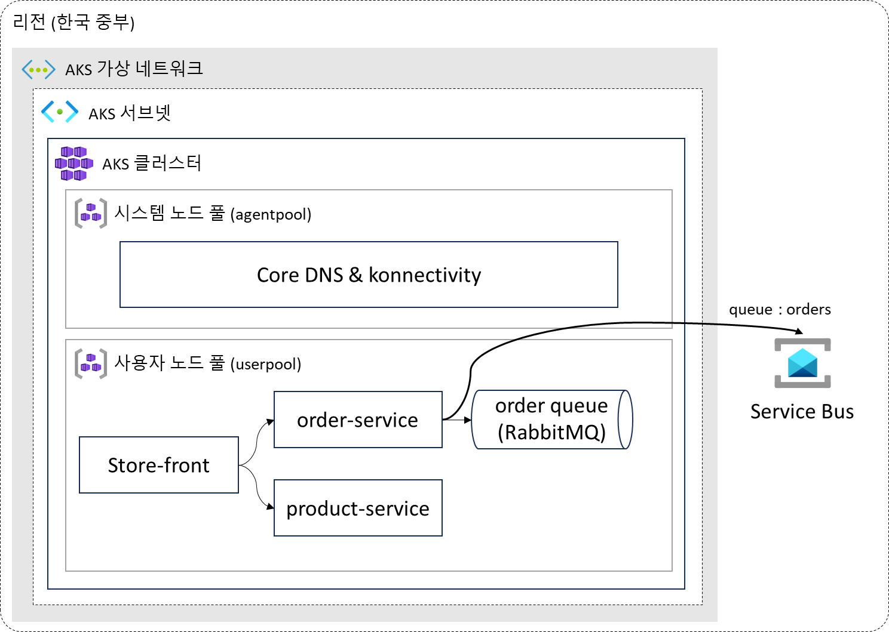

# AKS Basic Workshop

**수준 L200~300 · 예상 소요 시간 4시간 · 이론 및 실습 세션**

## 워크샵 개요

이 워크샵은 Azure Kubernetes Service(AKS)를 소개하는 이론 세션과, AKS 클러스터 및 샘플 애플리케이션을 구성하는 실습 세션으로 이루어집니다.

| 세션 | 내용 | 예상 시간 |
|---|---|---|
| 이론 | AKS 소개 | 40분 |
| 실습 | 샘플 앱의 로컬 실행, ACR 구성, AKS 클러스터 생성과 앱 배포, Service Bus 연동, 리소스 정리 | 180분 |
| 휴식·질의응답 | 중간 휴식과 질문 정리 | 20분 |

총 240분의 권장 시간 배분입니다. 실습 단계 수와 설치·빌드·리소스 생성 대기 시간을 고려한 예상값이며 실측값은 아닙니다. 도구 설치와 리소스 생성 대기 시간은 실습 환경에 따라 달라질 수 있습니다.

샘플 애플리케이션은 화면을 제공하는 `store-front`, 상품 정보를 제공하는 `product-service`, 주문을 처리하는 `order-service` 세 개의 컨테이너로 이루어집니다. 주문 큐를 처리하는 RabbitMQ 컨테이너도 함께 구성합니다. 마지막 실습에서는 주문 큐를 Azure Service Bus로 변경합니다.

## 학습 목표

- Docker로 샘플 애플리케이션을 빌드하고 로컬에서 실행합니다.
- Azure Container Registry(ACR)에 이미지를 업로드하고 AKS에 배포합니다.
- 주문 서비스를 Service Bus 큐에 연결하고 전달된 주문을 확인합니다.

## 사전 요구사항과 실행 환경

Azure 포털과 로컬 터미널을 함께 사용합니다. Docker Desktop, Git, Azure CLI, kubectl 준비는 [01. 준비 사항](./01-prerequisites/README.md)을 따릅니다. Azure 구독과 실습 리소스를 만들 수 있는 권한이 필요합니다.

리소스는 Azure 포털에서 만들고, 이미지 빌드·업로드와 앱 배포는 로컬 터미널에서 진행합니다. Windows CMD 또는 Bash 중 하나를 선택하세요. 환경 변수 문법이 다른 단계는 셸별 예시를 따르고, `console` 코드 블록은 두 셸에서 같은 명령으로 실행합니다.

아래 예시의 리소스 이름을 변경했다면 이후 명령과 삭제 단계에도 같은 이름을 사용합니다. `<alias>`와 `<your-...>` 표시는 자신의 값으로 바꿉니다. 실제 키나 키를 넣은 manifest는 Git에 커밋하거나 공유하지 않습니다.

## 실습 경로

| 순서 | 랩 | 예상 시간 |
|---|---|---|
| 01 | [준비 사항](./01-prerequisites/README.md) | 20분 |
| 02 | [샘플 애플리케이션 구성](./02-sample-application/README.md) | 35분 |
| 03 | [컨테이너 레지스트리 만들기](./03-container-registry/README.md) | 25분 |
| 04 | [AKS 클러스터 만들기](./04-aks-cluster/README.md) | 30분 |
| 05 | [클러스터에 애플리케이션 배포](./05-application-deployment/README.md) | 25분 |
| 06 | [PaaS 연동](./06-service-bus-integration/README.md) | 30분 |
| 07 | [리소스 정리](./07-cleanup/README.md) | 15분 |

랩별 시간의 합계는 180분입니다. 정상적인 네트워크와 리소스 생성 권한을 전제로 하며, Docker Desktop의 최초 설치·재부팅이나 네트워크·할당량 문제 해결에는 추가 시간이 필요할 수 있습니다.

## 비용과 정리

AKS, ACR, Service Bus와 모니터링 리소스에는 비용이 발생합니다. 실제 비용은 리전·리소스 설정·사용 시간·구독 계약에 따라 달라집니다. [Service Bus 랩의 비용 안내](./06-service-bus-integration/README.md#비용-확인)와 [Azure 가격 계산기](https://azure.microsoft.com/ko-kr/pricing/calculator/)에서 실행 전에 확인합니다. 총 4시간은 교육 일정이며 리소스의 과금 시간을 제한하는 값이 아닙니다.

실습을 마치면 [07. 리소스 정리](./07-cleanup/README.md)를 수행합니다. 중간 랩에서 다음 랩에 필요한 리소스를 삭제하지 않습니다.

## 실습 성공 확인

다음 항목을 확인하면 실습 목표를 달성한 것입니다.

- 로컬 브라우저에서 샘플 앱이 열립니다.
- 세 앱 이미지가 ACR에 업로드되고, AKS의 앱 Pod가 준비 상태가 됩니다.
- AKS의 `store-front` 공용 IP로 앱에 접속할 수 있습니다.
- 앱에서 주문을 만들면 Service Bus의 `orders` 큐에서 주문 메시지를 확인할 수 있습니다.

주문 메시지까지 확인했다면 [리소스 정리](./07-cleanup/README.md)로 이동해 클라우드 리소스와 로컬 컨테이너를 정리합니다.

## 참고 자료

이 실습은 [Microsoft Learn - AKS 자습서](https://learn.microsoft.com/ko-kr/azure/aks/tutorial-kubernetes-prepare-app?tabs=azure-cli)를 참고하여 작성되었습니다. 실행 코드는 외부 [Azure-Samples/aks-store-demo](https://github.com/Azure-Samples/aks-store-demo)에서 복제하며 이 저장소에 포함하지 않습니다.

## 라이선스와 거버넌스

자체 작성 코드와 실행 코드 예제에는 [MIT 라이선스](./LICENSE.md), 문서 설명문에는 [CC BY-SA 4.0](./LICENSE-DOCS)을 적용합니다. 현재 이미지·스크린샷과 타사 자료는 새 라이선스 적용 대상에서 제외합니다. 외부 샘플과 타사 자료의 기존 고지·라이선스는 보존하며, 자세한 적용 범위는 [문서 라이선스 안내](./LICENSE-DOCS)를 따릅니다.

보안 신고는 [보안 안내](./SECURITY.md), 기여는 [기여 안내](./CONTRIBUTING.md), 도움 요청은 [지원 안내](./SUPPORT.md)를 참고합니다. 참여자는 [행동 강령](./.github/CODE_OF_CONDUCT.md)을 따릅니다.